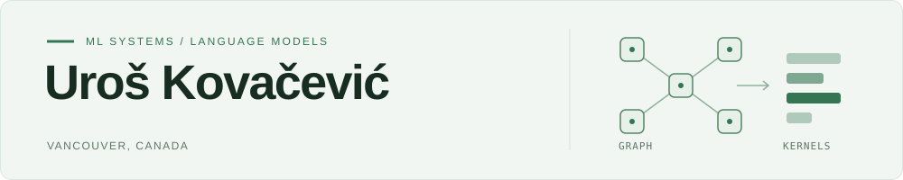

<picture>
  <source media="(max-width: 600px) and (prefers-color-scheme: dark)" srcset="assets/header-mobile-dark.svg">
  <source media="(max-width: 600px)" srcset="assets/header-mobile-light.svg">
  <source media="(prefers-color-scheme: dark)" srcset="assets/header-dark.svg">
  
</picture>

  <a href="https://uroskovacevic.com/resume">&nbsp;Résumé</a>
  &nbsp;·&nbsp;
  <a href="https://linkedin.com/in/ur0s">&nbsp;LinkedIn</a>
  &nbsp;·&nbsp;
  <a href="mailto:uros.dev@icloud.com">&nbsp;Email</a>

I'm a computer science student at **Simon Fraser University**, interested in the software that makes machine learning work: automatic differentiation, language model inference, and efficient model execution. I like understanding the layers beneath the abstractions and keeping the software above them simple.

**Right now:** studying ML compiler internals through [tinygrad](https://github.com/tinygrad/tinygrad).

### Skills

**Languages**

  
  
  
  
  
  
  
  
  

**ML & research**

  
  
  
  
  
  
  
  
  

- **Foundations:** Autograd · Backpropagation · Transformers · Attention mechanisms · Autoregressive generation
- **Training:** Training loops · SGD / Adam · Gradient clipping · Normalization
- **Research:** NLP · LLM evaluation · Machine unlearning evaluation · Retrieval · BM25 · ROUGE-L · Dataset construction · Data pipelines · Experiment analysis

**Systems & applications**

  
  
  
  
  
  
  
  
  
  
  
  
  
  
  

Make · GDB · Valgrind · CI/CD · REST APIs · WebSockets · AWS (EC2, S3, Lambda)

**Currently learning**\
ML compiler internals · Graph lowering · Kernel scheduling · Triton · GPU kernel autotuning · Roofline modeling · pybind11

### Experience

**Undergraduate Researcher · NLP** · Simon Fraser University\
May to August 2026 · LLM unlearning evaluation

Studied whether language models can forget a specific person without losing knowledge of people with similar names. Extended RWKU with a benchmark of **1,000 ambiguity groups**, built a Wikipedia data pipeline, and evaluated **54,000 responses across three LLMs**. Improved identity-aware retrieval to reduce false links by **53%** on held-out neighbor questions.

### Selected builds

- **[TinyTorch ↗](https://github.com/kovac04/TinyTorch)**: A small autograd engine with tensor operations, broadcasting, neural-network layers, and optimizers. Built to understand backpropagation from the inside.\
  Python · NumPy
- **[GPT from Scratch ↗](https://github.com/kovac04/Transformer)**: A decoder-only transformer with causal multi-head attention, pre-LayerNorm blocks, and autoregressive text generation.\
  Python · PyTorch · NumPy
- **[Motion Coach ↗](https://github.com/kovac04/motion-coach)**: Wearable movement analysis, from ESP32 IMU streaming over BLE to PCA-based calibration, rep segmentation, and real-time feedback.\
  Python · FastAPI · React · TypeScript · ESP32
