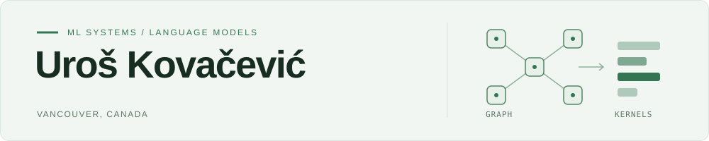
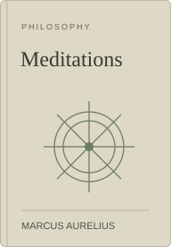
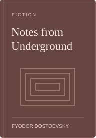
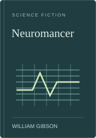
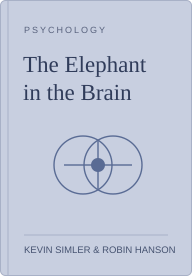

<picture>
  <source media="(max-width: 600px) and (prefers-color-scheme: dark)" srcset="assets/banner-mobile-dark.svg">
  <source media="(max-width: 600px)" srcset="assets/banner-mobile-light.svg">
  <source media="(prefers-color-scheme: dark)" srcset="assets/banner-dark.svg">
  
</picture>

  <a href="https://uroskovacevic.com">&nbsp;Website</a>
  &nbsp;·&nbsp;
  <a href="https://uroskovacevic.com/resume">&nbsp;Résumé</a>
  &nbsp;·&nbsp;
  <a href="https://linkedin.com/in/ur0s">&nbsp;LinkedIn</a>
  &nbsp;·&nbsp;
  <a href="mailto:uros.dev@icloud.com">&nbsp;Email</a>

I'm a computer science student at **Simon Fraser University**, building across machine learning systems, language model research, and embedded software. I like understanding the layers beneath the abstractions and keeping the software above them simple.

**Right now:** studying ML compiler internals through [tinygrad](https://github.com/tinygrad/tinygrad): graph lowering, kernel scheduling, and efficient model execution.

### Skills

**Languages** &nbsp; Python · C++ · C · Rust · SQL · TypeScript  
**ML & research** &nbsp; PyTorch · NumPy · pandas · scikit-learn · Hugging Face Transformers · LLM evaluation  
**Systems & applications** &nbsp; Linux · Docker · CMake · GDB · ESP32 · BLE · FastAPI · React

### Experience

**Undergraduate Researcher · NLP** — Simon Fraser University  
May–August 2026 · LLM unlearning evaluation

Studied whether language models can forget a specific person without losing knowledge of people with similar names. Extended RWKU with a benchmark of **1,000 ambiguity groups**, built a Wikipedia data pipeline, and evaluated **54,000 responses across three LLMs**. Improved identity-aware retrieval to reduce false links by **53%** on held-out neighbor questions.

### Selected builds

- **[Motion Coach ↗](https://github.com/kovac04/motion-coach)** — Wearable movement analysis, from ESP32 IMU streaming over BLE to PCA-based calibration, rep segmentation, and real-time feedback.  
  Python · FastAPI · React · TypeScript · ESP32
- **[GPT from Scratch ↗](https://github.com/kovac04/Transformer)** — A decoder-only transformer with causal multi-head attention, pre-LayerNorm blocks, and autoregressive text generation.  
  Python · PyTorch · NumPy
- **[TinyTorch ↗](https://github.com/kovac04/TinyTorch)** — A small autograd engine with tensor operations, broadcasting, neural-network layers, and optimizers. Built to understand backpropagation from the inside.  
  Python · NumPy

### Away from the editor

Philosophy, science fiction, and writing that makes me rethink my assumptions. A few from [my reading shelf](https://uroskovacevic.com/readings):

  
  &nbsp;
  
  &nbsp;
  
  &nbsp;
  

**Worth a tab**

<a href="https://grugbrain.dev/"> &nbsp; The Grug Brained Developer</a> — simplicity over cleverness.  
<a href="https://www.lesswrong.com/tag/map-and-territory"> &nbsp; Map and Territory</a> — better maps, clearer thinking.  
<a href="https://www.henrikkarlsson.xyz/p/training-data"> &nbsp; Scraping Training Data for Your Mind</a> — Henrik Karlsson on choosing your influences.  
<a href="https://commoncog.com/tacit-knowledge-is-a-real-thing/"> &nbsp; Why Tacit Knowledge Is More Important Than Deliberate Practice</a> — Cedric Chin on learning what words can't teach.

Outside of software: lifting, and four years of judo & sambo.
